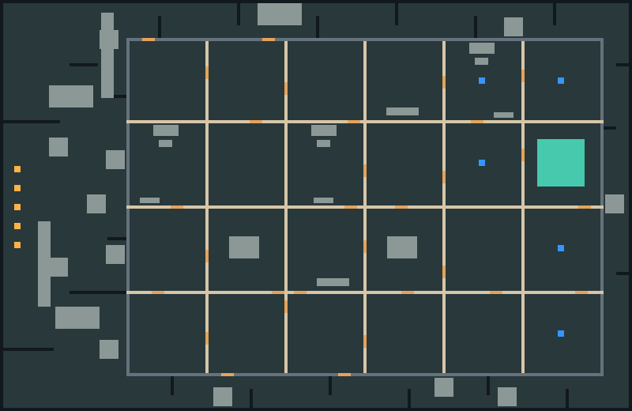

# CQC 1 validation and tuning

Select **CQC 1** with **Change map** in the host lobby. It uses the attack/defend round mode, fixed loadouts and the existing movement/combat rules.

## Source and regeneration

`scenes/maps/cqc_1/layout.txt` is the source of truth. Do not edit the generated scene. Regenerate both the scene and lobby preview:

```sh
godot4 --headless --path . -s tools/build_map.gd -- --ephemeral-profile --layout=res://scenes/maps/cqc_1/layout.txt --out=res://scenes/maps/cqc_1/cqc_1.tscn --preview=res://scenes/maps/cqc_1/preview.png
```

The generator uses `round_map_template.tscn` and normalizes generated resource/node IDs for byte-identical output. Invalid grids, door runs, edge/overlapping doors, objective regions and insufficient spawns exit non-zero with a diagnostic. Prop/wall overlaps produce warnings; round-map validation rejects those overlaps in shipped generated maps.



The 200×130-cell map is 3200×2080 px and plays as an indoor fight. Dark walls are hard, slate walls reinforced, light walls soft, tan gaps doors, orange markers attacker spawns, blue markers defender spawns, teal the objective and grey blocks props.

- **Attackers** spawn on the street along the west edge, behind cars, a truck, crates and fences, and must flank to the house's four exterior doors (two on the north face, two on the south face; the west facade has none).
- **The house** (x 40–190, y 12–118) is a 6×4 grid of rooms about 24×25 cells, joined by 26 interior doors placed so that no straight line runs through a chain of doorways. Every room is reachable, with several loops.
- **Defenders** spawn in the east rooms around the **objective room** (east column, second row; 15×15-cell zone), which has three approaches.
- **Furniture** (sofas, coffee tables, TV stands, dining sets, kitchen counters; 13 pieces) blocks movement only. **Cover** (12 crates, 3 cars, 2 trucks) and hard fence segments break up the street and the yards round the house.

Wall materials only affect how much sound passes; no wall can be destroyed. All structural walls use one tile layer and its automatic fog mirror.

The layout was tuned against the same rules as the tests: a collision-clear grid route from every attacker spawn, a sampled open-door sight scan and spawn privacy. Door positions in parallel walls are offset (one near each end of a room) because aligned doorways create the long lines.

## Measured tuning

The player scene overrides the controller's base speed: normal running is **250 px/s**.

| Measurement | Result |
|---|---|
| Collision-clear grid routes, five attacker spawns to objective centre, doors open | 16.45 / 16.75 / 16.37 / 15.98 / 15.60 s |
| Actual normal puppet input through the server movement/collision pipeline, from spawn `(5, 59)` | **17.17 s** in the headless host/client run |
| Longest sampled open-door sight line (2-cell grid, 128 directions, 3 px ray steps) | about **1350 px**, below the 1440 px target |
| Opposing spawn visibility | Every attacker/defender spawn pair has blocking Environment cover |

Fence gaps in the yards are 4 cells (64 px): a 3-cell gap stopped the route puppet on the player capsule.

## Automated and rendered coverage

`tests/run_tests.sh unit cqc` checks generation, map contracts and the CQC scenario; `tests/run_tests.sh` runs all regressions. The Step 6 suite contains 149 checks: 56 unit and 93 network checks.

- Unit checks reject malformed layouts, check CLI failure status, verify saved objective size and both door orientations, and compare deterministic generated output.
- Every lobby round map is checked for required services, five clear spawns per role (24 px radius), attacker distance of at least 1400 px, one objective and known wall materials. Generated cells, objective size, doors, props and spawn transforms are compared with fresh generation. Deliberately blocked spawns and stale cells must fail validation.
- The legacy dev round map now has five clear spawns per role. Its second attacker spawn is repositioned to meet the objective-distance requirement.
- The `cqc` host/client scenario verifies map selection, that no wall material takes bullet, melee or explosive damage, crate break and fog replication, all nine doors, host teammate spectating, actual running time, objective capture and round reset of players, walls, crates with fog, and doors.
- The same eight network checks pass in two graphical Godot processes on one Mac. Inspected frames cover the lobby preview, spawn view, breach, open doors, spectating the approach, objective capture and reset. The capture helper explicitly requests a draw for idle/occluded windows; image work stays outside movement timing.

Reproduce the rendered scenario in two terminals, substituting an available Godot binary:

```sh
# Host
godot4 --path . res://tests/net/net_test.tscn -- --ephemeral-profile --net-test=cqc --map=res://scenes/maps/cqc_1/cqc_1.tscn --port=3370 --role=host --capture-dir=/tmp/greyline-step6

# Client
godot4 --path . res://tests/net/net_test.tscn -- --ephemeral-profile --net-test=cqc --map=res://scenes/maps/cqc_1/cqc_1.tscn --port=3370 --role=client --capture-dir=/tmp/greyline-step6
```

## Remaining human playtest

A two-human playtest on separate machines has not been performed here. Full rounds still need a balance/feel pass with two humans plus puppets: attack each entrance, shoot through crate cover, hold the objective as defender, judge sound cues during pushes, confirm spawn privacy in play, and walk every wall to look for awkward corners. The automated route and rendered loopback checks do not replace that checklist.
